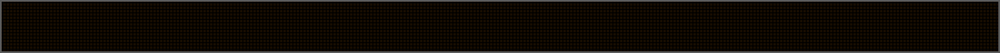

<div align="center">

<table>
<tr>
<td align="center" valign="top"><br><br><br><br><br><br></td>
<td align="center">


<h2>~*~ Welcome to my DOS Sound Page!!! ~*~</h2>

<i>A Roland Sound Canvas for your DOS games. No MIDI hardware needed!!</i>

<br><br>


<br><br>


<br>

<sub>this page is ALWAYS under construction... please come back soon!! :-)</sub>

<br><br>

<a href="https://github.com/deon81997/NUKED-SBEMU-MUXED/releases/latest"></a>


<br><br>

</td>
<td align="center" valign="top"><br><br><br><br></td>
</tr>
</table>

<b>Release counter:</b><br>
<br>
<sub>betas and counting!</sub>

<br><br>

<a href="#-whats-new-"></a>

<br><br>


<br>

<b>~ SITE MAP ~</b> <sub>(click a button!!)</sub>

<table>
<tr><td><a href="#-whats-new-"></a></td><td><a href="#-what-is-this-"></a></td><td><a href="#-cool-features-"></a></td><td><a href="#-will-it-run-on-my-pc-"></a></td></tr>
<tr><td><a href="#-my-test-lab-"></a></td><td><a href="#-getting-started-"></a></td><td><a href="#-usb-gamepads-in-dos-"></a></td><td><a href="#-supported-sound-chips-"></a></td></tr>
<tr><td><a href="#-screenshots-"></a></td><td><a href="#-hall-of-fame-"></a></td><td><a href="#-built-with-claude-"></a></td><td><a href="#-made-for-this-pack-"></a></td></tr>
<tr><td><a href="#-download-zone-"></a></td><td><a href="#-sign-my-guestbook-"></a></td><td><a href="#-for-the-nerds-source-code-"></a></td><td><a href="#-thanks-to-my-friends-"></a></td></tr>
</table>


</div>

<br>


<div align="center"><sub><i>^^^ the main menu, running in plain DOS ^^^</i></sub></div>

<div align="center">    </div>

## ★ What's NEW!! ★

 **11/10/2026: beta.91.** **CD games from MENU find the right disc!!** Starting a second
CD game from MENU in the same session kept the FIRST game's disc in drive M: (uCDD has one drive and refused the
second mount), so the game said "no CD", or failed with read or init errors. MENU now takes the old disc out first,
and if a disc still cannot be mounted it says so and does not start the game. Tested in 86Box: disc swap works, and
Doom runs straight from the virtual drive with SBEMU and the SC-55 loaded (its WAD read back bit-identical).

 **11/10/2026: beta.90-w98.6.** **Windows 98 catches up with DOS!!** MIDPLAY in a Windows
DOS box now shows the SC-55's (or MT-32's) REAL display, live, just like in DOS: the Windows driver answers its
front-panel query now. The Windows side also runs on the same CPUs as DOS: SC55W.EXE picks the fast SSE2 build on a
Pentium 4 / M and newer, and a Pentium II build on a Pentium II / III or Athlon XP (before, those could not run it at
all). And a MIDPLAY fix: in a Windows DOS box its clock could think the CPU ran at a few MHz (Windows delivers the
BIOS timer late and in bursts) and raced to the end of a song; it now calibrates over a full second there.

 **11/10/2026: beta.89-w98.5.** **Blood sounds right in Windows 98!!** Blood's effects
(Sound Blaster 16, 44 kHz) came out in short bursts with gaps in a Windows DOS box. Recorded in our Windows 98 test PC:
only about 40 ms of sound in every 120 ms. The cause: a full-screen DOS game gets most of the CPU, and Windows then
runs our sound program only in short turns, so its 80 ms buffer ran dry in between. Now the buffer grows by itself
(160, then 300 ms) while a DOS game plays sound and the output keeps running dry, and shrinks back a minute later.
Gaps in the Blood test: 56% of the time before, 1% now (the game's own pauses).

 **11/10/2026: beta.89.** **The SC-55 needs 11-14% less CPU, same sound bit for bit!!**
The SC-55 emulation is now built with profile-guided optimization: we ran an instrumented build in DOS to record which
code paths are hot, and the compiler used that to lay out the code. 86Box, Pentium II 450: SC55WAV renders 13.6% faster
(18000 -> 20456 audio frames a second, the WAV identical to the last byte), and live in SBEMU the SC-55 load went
from 340% to 302% of that slow test PC. More headroom on every PC, and slower PCs get closer to real time.

 **11/10/2026: beta.88.** **The 3D menus get a 90s glow-up!!** The 3D screens now take
their colours from the text menu's colour style (Groovy, Sunset, Ocean, Neon, Candy, Midnight): sky, grid floor and
accents all change, also in MIDPLAY. **F6** in the 3D menu cycles them. Titles and the chosen item glow like neon.
Carousel: glowing markers for every place on the ring, "2 / 5" and arrows. Module: brushed metal, a backlit LCD
glow and a machined knob with a pointer line. No speed lost: Panels even went from 10.1 to 11.2 frames a second.

<details>
<summary><b>&gt;&gt; Older news &lt;&lt;</b></summary>

<br>

 **11/10/2026: beta.87.** **Cleaner 3D screens!!** The bigger letters on every 3D screen
(menu, SETTINGS, CD images, GAMETEST, MIDPLAY) now have their stair-steps smoothed: rounder curves, crisp straight
strokes. In the Carousel and Module menus the description no longer runs into the key help: it gets its own three
lines and the keys sit below a divider.

 **11/10/2026: beta.86.** **Snappier 3D menus, and the version on screen!!** The MENU now
shows which version you run (yellow, under the logo), no more digging in SBLOG.TXT. The 3D menu styles got quicker:
Panels' moving background now uses whole-number math (it did a slow float conversion for every pixel), and
Carousel's see-through mirror floor is drawn row by row like MIDPLAY's. 86Box, Pentium II 450 at full 640x480:
Panels 8.5 -> 10.1 frames a second, Carousel 8.6 -> 11.4.

 **11/10/2026: beta.85.** **MIDPLAY's 3D view, 3x smoother!!** On the D810 it showed
only 5-6 pictures a second. It used to rest between frames to leave the CPU to the music, which is no longer needed
since beta.83 sends the music while drawing: now it draws as fast as the PC allows, up to 60 a second. The grid floor
(half of every frame) is now drawn row by row, about 3x faster, and the 3D menus get that too. 86Box, Pentium II 450
with the SC-55 busy: 41 frames in 30 s before, 140 now, music still on time. The playlist now shows the file name
first, then the title.

 **11/10/2026: beta.84.** **A hidden bug squashed: 3D games and SBEMU get along!!**
Thin black lines across MIDPLAY's new 3D view led us to an old bug: SBEMU's sound interrupt and its Sound Blaster,
joystick, PC speaker and FM handlers used the CPU's floating point unit without saving the game's own values. A game
in the middle of its 3D math (MIDPLAY's 3D view, Quake-style games) could get garbage numbers back: stray lines or
polygons, jumpy objects, the odd crash, and only while SBEMU ran. Now SBEMU keeps the game's FPU state safe every time
it steps in. Tested in 86Box: 6-10 broken lines in every 3D frame before, none now, and MIDI timing unchanged.
New MIDPLAY screenshots below ([playlist](docs/shots/midplay-playlist.png), [files](docs/shots/midplay-files.png),
[options](docs/shots/midplay-options.png)).

 **11/10/2026: beta.83.** **MIDPLAY, the MIDI player, made over!!** Five pages
(Player, Playlist, Files, Options, Help) and the music keeps playing and moving to the next song on all of them. The
playlist shows every song's title and length, finds songs as you type, sorts, reorders, and saves or opens .M3U lists;
the file browser opens where your song is and shows a song's title and length before you play it. New: speed 25-400%,
mute or solo any channel, click the time bar to jump, and "start where I quit". No more stutter when you change views
or pages: the music is now sent while the screen is drawn, the graphics modes only redraw what changed, and the timing
uses the CPU's own clock. Measured in 86Box (Pentium II 450, SBEMU playing a very busy MIDI): notes came up to
**252 ms late before** (15 ms in the text views), **now at most 8 ms in every display mode**. The 3D view is always sharp
full 640x480.

 **11/10/2026: beta.82.** **Virtual CDs work like a real disc!!** Games no longer
stop with a CD read error: on a PC with its own CD-ROM driver loaded (like a Windows 98 boot), games asked DOS for "the
first CD drive" and got your empty real drive instead of the mounted image. Now drive M: is the first CD drive and your
real drive keeps D:. The virtual drive also plays CD music by itself like a real one (play, pause, resume, track time,
"busy until the track ends"), so games that start or wait for their music don't fail or hang, with or without SBEMU, and
CUE sheets with PREGAP lines play the right spot. New driver built from source: uCDD 0.9.5-a3 plus our CD-audio part,
and SHSUCDX with a new /P option. No CPU used while nothing reads the disc.

 **11/10/2026: beta.81-w98.4.** **Lighter on your CPU!!** NUKED SB-EMU for Windows 98
now really rests when nothing plays: the sound output pauses while it's silent (and wakes up within a blink when a game or
a MIDI file starts), Windows' timer is no longer kept at 1000 ticks a second, the joystick check slows down when no game
uses it, and a sleeping SC-55 no longer costs more than a playing one. Measured in 86Box on a Pentium II 450 with
Windows 98 idle: **1.6% of the CPU before, 0.25% now.** In plain DOS the Nuked OPL3 core goes to sleep after two seconds
of silence (some games leave silent notes playing forever) and the SC-55 stops sooner after the music ends.
New setting `OutputSleep=0` in SC55W.INI if your sound card's driver ever misses the first note after a pause.

 **11/10/2026: beta.80-w98.3.** **Joysticks EVERYWHERE in Windows 98!!** The
settings window got tabs, and the new **Joystick** tab shows your pad live (sticks, buttons, what DOS games read). Pick the
game port's address (200-20F) and stick type (CH Flightstick Pro, Thrustmaster FCS, Gravis GrIP) for DOS boxes, and one
click on *Set up...* adds a **NUKED SB-EMU Game Port** to Device Manager and a **NUKED SB-EMU Joystick** to Game Controllers,
so Windows games get your pad too, even on PCs whose sound card has no game port. The **Pad keys** tab learns your pad's
buttons: click a box, press the button. ([joystick tab](docs/shots/w98-joystick-tab.png),
[pad keys tab](docs/shots/w98-padkeys-tab.png), [Device Manager](docs/shots/w98-gameport-devmgr.png))

 **11/09/2026: beta.80.** **Hold the button, the key repeats!!** Pad buttons now
repeat their key like a real keyboard, so menus and setup screens scroll when you hold the D-pad. Your dead zone setting
now also decides how far you push a stick before it presses a key, and holding the same key on the pad and a USB keyboard
no longer lets go too early. Also fixed: keys could get stuck after fast repeating on some BIOSes. Tested with 13 more
games from a shareware CD (Bio Menace, Duke 1, Gods, Keen 1/4/6, Keen Dreams, Major Stryker, Epic Pinball, Spear of
Destiny, Wolf3D...) plus Doom II and the full Wolf3D, all played from the pad
([screenshots](docs/padkeys-tests/README.md)).

 **11/09/2026: beta.79.** **Your pad presses the keys in plain DOS too!!** The
per-game button layouts from beta.77-w98.2 now work outside Windows: SBEMU sees which game you start and gives your
USB pad that game's keys, so in Commander Keen A jumps, B fires and X pogos, and in Doom RB fires and Y opens the menu.
It finds the game by its EXE or by the files in its folder, and goes back to the normal layout when you quit. Same free
download, same PADUSER.TXT for your own layouts. `SBEMU /PADLOG` shows which layout it picked.

 **11/09/2026: beta.78.** **The USB mouse behaves!!** On some PCs (very likely the
D810 too) a USB mouse in plain DOS jumped around and clicked by itself, and on others it didn't move at all. Those BIOSes
read a whole mouse packet at once, and SBEMU was sending it one byte at a time. Now every packet goes to the mouse
driver in one piece, right next to your touchpad's. The JEMM launchers got the same fix.

 **11/09/2026: beta.77-w98.2.** **Your pad presses the keys!!** In Windows 98
DOS boxes the game pad's buttons now type the right keys for the game you're playing: jump, fire, pogo, menu. Download
one free file (the Keyb2Joypad layouts from DOSBox Pure, link in DOWNLOADS.TXT) and over 3500 DOS games know their
buttons. Your own layouts go in PADUSER.TXT.

 **11/09/2026: beta.77.** **SETTINGS, CD images and GAMETEST in 3D!!** Same
three looks as the 3D menu (Panels, Carousel and Module), with mouse support and pop-ups that stay in 3D. Turn on the 3D
menu and they all follow; <kbd>F8</kbd> flips everything back to text.

 **11/09/2026: beta.76-w98.1.** **Xbox 360 pads in Windows 98!!** The pack now
comes with an unofficial Windows 98 driver for the 360 controller (and HORI, Mad Catz, Logitech and Saitek pads), with
English install steps. Plug your pad in and the NUKED SB-EMU even tells you where the driver is. Then it works in
Windows games and in DOS games in DOS boxes, left stick and right stick both!

 **11/09/2026: beta.76.** Laptop gamers rejoice!! A **USB mouse now
works right next to your touchpad** in plain DOS, no JEMM needed. Before, the mouse driver found the touchpad
and the USB mouse just sat there. You can even plug it in while a game is running.

 **11/09/2026: beta.75.** **Joysticks in DOS boxes!!** Any controller Windows 98
knows about now works in DOS games inside Windows too, on the game port and through the BIOS, so a 360 pad with its
Windows driver can play your DOS games without leaving Windows. And Windows games' music volume sliders now work
on the NUKED SB-EMU MIDI device.

 **11/09/2026: beta.74.** The **Windows 98 part** gets its first update in ages!!
It now has the faster SC-55 too, and it can't hog the CPU any more: when the synth can't keep up, the music lags
instead of Windows. Started with Windows, it waits 15 seconds so Windows can finish starting first. And if Windows
ever freezes while it's starting, the next boot skips it and tells you where it got stuck.

 **11/09/2026: beta.73.** SBEMU loads more than **twice as fast**!! On
a 366 MHz Celeron it went from 15 seconds to under 7. A ROM check was being redone almost every time by
mistake, and now it isn't. Plus a garbled line on the start screen is fixed.

 **11/09/2026: beta.72.** MIDPLAY goes **3D**!! Press S until you get a
little sound module with the synth's live display, a keyboard that lights up as the notes play, and dancing
channel columns. And <kbd>F3</kbd> now switches the colour style in *every* program, not just the menu.

 **11/09/2026: beta.71.** CUE images with CD music can be taken out and
swapped again! Before, they got stuck on drive M: until you rebooted. Oops.

 **11/09/2026: beta.70.** Big bug hunt! MIDPLAY redraws properly after
the file browser, all the menu text fits now, and Automatic setup is minutes
faster on slow PCs.

 **11/09/2026: beta.69.** The SC-55 got **~20% faster**!! It sounds
*exactly* the same (I checked every single sample), it just does less
pointless work.

**11/08/2026: beta.68.** Dark Forces' setup doesn't freeze with the SC-55
anymore.

<details>
<summary><b>&gt;&gt; Click here to read how the speed-up works &lt;&lt;</b></summary>

<br>

The SC-55 is a little computer inside a box: a Hitachi H8 CPU running Roland's
firmware, plus a custom sound chip. Nuked-SC55 emulates all of it, every clock
tick. That's why it sounds right, and that's why it's hungry. beta.69 cuts
out work that never changes the result:

* the chip's timers only get stepped when a tick actually matters
* wave ROM reads use a lookup table instead of a chain of checks
* the CPU loop skips the sound chip and the A/D converter while they're idle

Output was compared against the old version sample by sample, on every ROM
set, with effects on and off: identical. It's about 19% fewer instructions per
second of music, which came out as **+24% on a Celeron 366** (0.28× → 0.35×
real time).

And since beta.68, with automatic speed control on (the default), the synth
never takes more than about 60% of the CPU, so your game always gets the rest.
</details>

</details>

<div align="right"><a href="#top"></a></div>

<div align="center">    </div>

## ★ What is this?? ★

Ever fire up Doom on an old laptop and the music starts and it's... FM? It's
fine, but you *know* how it's supposed to sound. It's supposed to sound like a
**Roland Sound Canvas**.

NUKED SB-EMU puts one inside your PC! It's [SBEMU](https://github.com/crazii/SBEMU)
(a Sound Blaster 16 + OPL3 emulator that runs in plain DOS on PCI sound chips)
with a real SC-55 built in: [Nuked-SC55](https://github.com/nukeykt/Nuked-SC55)
runs the actual Roland firmware from your own ROM dumps. So it's not "a
SoundFont that sounds kinda close". It's the real thing!! Then I added a
virtual CD drive with CD music, USB gamepads in DOS, a Windows 98 side, and
menus for all of it.

It's made and tested on my **Dell Latitude D810** and my **ASUS P5PE-VM** Windows 98 / DOS
tower ([my test lab](#-my-test-lab-)), plus a LOT of testing in QEMU and 86Box. It's still beta, so if
something breaks please [sign my guestbook](#-sign-my-guestbook-) and tell me!

> [!IMPORTANT]
> **ROMs are NOT included!!** Bring your own SC-55 (and MT-32 / CM-32L) dumps.
> They're recognised by what's inside them, so the file names don't matter.

<div align="right"><a href="#top"></a></div>

<div align="center">    </div>

## ★ Cool Features ★

<table>
<tr><td>🔊</td><td><b>Sound Blaster 1.x / 2.0 / Pro / 16 + OPL3 FM</b> in pure DOS, on your PCI sound chip</td></tr>
<tr><td>🎹</td><td><b>Roland SC-55 and SC-55mkII</b>: the real firmware, from your ROMs</td></tr>
<tr><td>🎼</td><td><b>Roland MT-32 / CM-32L</b> (Munt), or any <code>.SF2</code> SoundFont</td></tr>
<tr><td>💿</td><td><b>Virtual CD drive M:</b> that works like a real disc: ISO, CUE/BIN, multi-disc, CD music played by the drive and mixed in</td></tr>
<tr><td>🎮</td><td><b>USB game pads</b> as gameport joysticks (up to two), plus USB keyboard and a USB mouse right next to your touchpad</td></tr>
<tr><td>🕹️</td><td><b>The pad presses each game's own keys</b>: jump, fire, pogo, menu, for over 3500 DOS games, in DOS and Windows 98</td></tr>
<tr><td>🪟</td><td><b>Windows 98</b>: SB / OPL3 / MPU for DOS boxes, a "NUKED SB-EMU" MIDI device, a joystick + game port for every game, and barely any CPU while idle</td></tr>
<tr><td>🖥️</td><td><b>Menus for everything</b>: seven colour styles, 3D screens (menu, settings, CD images, GAMETEST, MIDI player), game profiles, tests</td></tr>
<tr><td>🎵</td><td><b>MIDPLAY</b>: a full-screen MIDI player with playlist, file browser, options, a live SC-55 front panel and a smooth 3D view</td></tr>
<tr><td>🐞</td><td><b>One-key bug report</b>, start-up logs and a live load meter</td></tr>
</table>

<details>
<summary><b>&gt;&gt; Sound Blaster, FM and PC speaker &lt;&lt;</b></summary>

- Sound Blaster 1.x, 2.0, Pro, Pro 2 and 16: 8- and 16-bit DMA, mono, stereo, high-speed modes, Creative ADPCM
- Any port (220 / 240), IRQ (5 / 7 / 9) and DMA; `BLASTER` is set for games automatically
- If your sound chip already sits on the IRQ you picked, SBEMU grabs a free one instead of giving up
- OPL3 FM: [Nuked-OPL3-fast](https://github.com/tgies/Nuked-OPL3-fast) (cycle-accurate) or DOSBox's fast core; hardware FM pass-through on cards that have it
- PC speaker sound mixed into the output
- Protected-mode games out of the box (HDPMI32i); real-mode games with JEMMEX + QPIEMU (included) or QEMM
- 16-bit protected-mode games (Borland Pascal / C++ DPMI, like Jazz Jackrabbit) with SBEMU16 + HDPMI16I (`SC55J16.BAT`)
</details>

<details>
<summary><b>&gt;&gt; MIDI: SC-55, MT-32, CM-32L, SoundFont &lt;&lt;</b></summary>

- **SC-55** (mk1 v1.00 – v2.00) and **SC-55mkII** (v1.01), ROM sets found by content, the best one picked for you
- **MT-32** and **CM-32L / LAPC-I** with Munt 2.8.5
- **SoundFont** (`.SF2`) with reverb and chorus, for slower PCs
- MPU-401 on any port (330, 300, 310, 320, 332, 334)
- Render-ahead buffer and automatic speed control keep the music smooth while games run
- **Automatic setup** measures each ROM set on your CPU and picks the best one it can handle
- **Front panel in games**: <kbd>Ctrl</kbd>+<kbd>Alt</kbd>+<kbd>F12</kbd> shows the SC-55 / MT-32 display over the game
- `MIDPLAY`: MIDI player with five pages (player, playlist, files, options, help): titles and lengths read in the background, type-to-find, sorting, .M3U lists, speed 25-400%, mute/solo per channel, resume where you quit, a live SC-55 front panel and a sharp 640×480 3D view, in every text and VESA mode
- `SC55WAV` / `SC55LOG`: render an SC-55 demo to WAV and see how fast your PC runs each ROM set
</details>

<details>
<summary><b>&gt;&gt; Virtual CD drive and CD music &lt;&lt;</b></summary>

- Mounts `.ISO`, `.CUE/.BIN` (raw or 2048-byte) and multi-disc games on drive **M:** (uCDD 0.9.5-a3 + SHSUCDX 3.09, both built from source)
- **M: is the first CD drive**, even when a real CD-ROM drive is there too, so games find the disc instead of your empty drive
- **The drive plays CD music by itself** like a real one: play, pause, resume, track time, "busy" until the track ends, PREGAP in CUE sheets
- **CD music played through your sound card**, mixed with the game (`HYBRID.BAT`)
- Swap discs while SBEMU runs; the music stops when a disc comes out
- CD images screen: disc label and date, track list with lengths, file list without mounting, run a disc's installer, fix broken CUE files
- Drivers for a **real CD-ROM drive** in DOS: XCDROM (included), VIDE-CDD, LG GSCDROM, MSCDEX
</details>

<details>
<summary><b>&gt;&gt; Menus and tools &lt;&lt;</b></summary>

- **MENU**: sound, settings, tests, games, CD-ROM and files in one place; shows whether SBEMU is loaded and the port, IRQ, DMA and MIDI port it really uses
- **Games**: per-game profiles (SBEMU options, CD image, arguments)
- **SETTINGS**: every option on one screen; changes apply to a running SBEMU straight away
- <kbd>F3</kbd> in any program switches the colour style for all of them
- **3D screens** for MENU, SETTINGS, CD images, GAMETEST and MIDPLAY in three looks (Panels, Carousel, Module), with the mouse; <kbd>F8</kbd> flips them all between 3D and text
- **GAMETEST**: runs games by itself (Doom demos, Duke 3D), measures music timing and finds each game's best settings
- Styles: Groovy, Classic, Sunset, Ocean, Neon, Candy, Midnight; a 3D menu (640×480, no 3D card needed); Terminus or VGA fonts; 80×25 up to 80×60 and your card's VESA text modes
- `SBDIAG`, `MPUTEST`, `TIMETEST`, `JOYTEST`, `USBTEST`, `KMTEST`, `CPUMHZ`, `PADCONV`
- `SETUP`, `CDINST`, `CLEANUP`, `UNINSTAL`: install and remove without touching `CONFIG.SYS` or `AUTOEXEC.BAT`
</details>

<details>
<summary><b>&gt;&gt; Windows 98 &lt;&lt;</b></summary>

- Virtual Sound Blaster (1.5 – 16), OPL3 and MPU-401 for DOS boxes (`SC55W.VXD`)
- **"NUKED SB-EMU" MIDI device** for Windows programs, played by the same synths
- Tray program with a settings window (tabs: Sound and MIDI, Joystick, Pad keys); settings shared with DOS
- **Joysticks**: any pad Windows knows plays DOS games in DOS boxes; *Set up...* adds a NUKED SB-EMU Game Port and Joystick so Windows games get it too, even without a game port on your sound card
- **Pad keys** per game in DOS boxes, and an Xbox 360 pad driver for Windows 98 (unofficial, with English install steps)
- Rests when nothing plays: about **0.25% CPU** while idle on a Pentium II
- See [`README98.TXT`](sc55-pack/pack/README98.TXT)
</details>

<div align="right"><a href="#top"></a></div>

<div align="center">    </div>

## ★ Will it run on my PC?? ★

Sound Blaster and FM run on anything with a Pentium. The SC-55 is the hungry
one, because it emulates Roland's hardware clock by clock. It needs a CPU with
CMOV (Pentium Pro / II or newer).

**What I measured** with `SC55LOG` / `SC55WAV` (1.0× = exactly real time):

| CPU | SC-55 mk1 v2.00 | |
|---|---|---|
| Celeron 366 (86Box) | **0.35×** (was 0.28×) | too slow, use a SoundFont |
| Celeron 533 (86Box, before beta.69) | 0.41× | too slow, but SB + FM are fine |
| Pentium M (my Dell D810) | plays live | the home machine!! |

**My best guess** for other CPUs, worked out from those numbers. Run
*Settings > Automatic setup* on yours for the real answer:

| SC-55 | Just about plays (≈1.0×) | Comfy (≈1.5×, the game keeps its share) |
|---|---|---|
| **mk1** | Pentium III / Celeron ≈ 1 GHz, Pentium M ≈ 900 MHz, Athlon XP 1200+ | **Pentium M ≈ 1.2 GHz, Pentium 4 ≈ 2.0 GHz, Athlon XP 1600+** |
| **mkII** (≈1.6–1.9× heavier) | Pentium M ≈ 1.5 GHz, Pentium 4 ≈ 2.4 GHz | Pentium M ≈ 2 GHz, Pentium 4 ≈ 3 GHz, Athlon 64 and up |

Too slow? Pick a **SoundFont** instead. It runs on a Pentium II no problem.
(Turning reverb/chorus off only helps a little: most of the work is the
emulated CPU, and that always runs at full speed.)

| You also need | Minimum | Nice to have |
|---|---|---|
| **Memory** | 32 MB (about 21 MB stay resident with the SC-55) | 64 MB or more |
| **Sound** | a PCI / onboard chip from the [big list](#-supported-sound-chips-) | Intel AC'97 or HD Audio |
| **DOS** | MS-DOS 6.22 / 7.x or FreeDOS, plain DOS | Windows 98 "Restart in MS-DOS mode" |
| **Disk** | about 25 MB, more for disc images | |

<div align="right"><a href="#top"></a></div>

<div align="center">    </div>

## ★ My Test Lab!! ★

Every release gets tried on real iron here, plus a whole fleet of emulated PCs:

<table>
<tr>
<td valign="top" width="50%">

<b>💻 Dell Latitude D810</b> (the home machine!!)

- Intel Pentium M
- ATI Mobility Radeon X300
- Intel ICH6 chipset, AC'97 sound, built-in touchpad
- Windows 98 SE / MS-DOS 7.1

</td>
<td valign="top" width="50%">

<b>🖥️ Custom Windows 98 / DOS tower</b>

- ASUS P5PE-VM motherboard
- Leadtek WinFast A400 (GeForce 6800)
- Creative Sound Blaster Audigy
- 2 GB RAM
- 3X DVD-ROM
- NEC uPD720101 USB 2.0 card + official wired Xbox 360 pad

</td>
</tr>
</table>

**Emulated:** 86Box (Celeron 366 for "how slow can it go?", Pentium II with Windows 98 SE) and QEMU, with custom
add-ons: a fake USB Xbox 360 pad, a joystick driven from a file and scripted keys and screenshots.

<div align="right"><a href="#top"></a></div>

<div align="center">    </div>

## ★ Getting Started ★

```text
  1. Download the zip, unzip it, put your ROM dumps in NUKEDSB\FILES\ROMS
  2. Boot DOS          (Windows 98: "Restart in MS-DOS mode")
  3. cd NUKEDSB
     SETUP             installs to C:\SC55
     CDINST            optional: virtual CD drive
  4. C:\SC55\MENU      and have fun!!
```

In each game's setup pick **Sound Blaster 16** and **General MIDI / Sound
Canvas** (or **MT-32**) with the values the menu shows in the top right corner:
usually 220, IRQ 7, DMA 1/5 and port 330. GAMETEST sets up Doom- and
Duke-style games by itself.

<details>
<summary><b>&gt;&gt; More: real-mode games, CD music, settings &lt;&lt;</b></summary>

- **Protected-mode games** (DOS/4GW and friends): `C:\SC55\SC55.BAT`, then the game
- **Real-mode games**: `SC55JEM.BAT` (JEMM + QPIEMU) or `SC55QMM.BAT` (QEMM, bring your own)
- **CD music**: put the image in `C:\CDIMAGES`, mount it in the CD images screen, start with `HYBRID.BAT`
- **Settings** live in `C:\SC55\SBOPTS.TXT`, shared by every launcher and Windows 98

The `README.TXT` in the pack is the full manual.
</details>

<div align="right"><a href="#top"></a></div>

<div align="center">    </div>

## ★ USB Gamepads in DOS?!? ★


Yep!! DOS games read an analog joystick on the gameport (port 201h), and SBEMU
answers there with a USB Xbox 360 pad: left stick = joystick A, right stick =
joystick B, A/B/X/Y = buttons 1-4, and Start / Back type Enter / Esc. Two pads?
Pad 1 is joystick A and pad 2 is joystick B. Games that ask the BIOS for the
joystick get the pad too.

<div align="center">

 <b>...and the pad presses each game's own keys!!</b> <br>


</div>

Since beta.79 SBEMU sees which game you start and gives the pad **that game's
keys**: jump, fire, pogo, map, menu. Over 3500 DOS games know their buttons (the
free Keyb2Joypad list from DOSBox Pure, one download, see DOWNLOADS.TXT), and
your own layouts go in PADUSER.TXT. Games without a layout get arrow keys on the
D-pad, Enter on Start and Esc on Back. Every game above was played with nothing
but the pad: [see all the screenshots](docs/padkeys-tests/README.md)!

- **Stick types** (`/JOYMODE`): standard, CH Flightstick Pro, Thrustmaster FCS, Gravis GamePad Pro (GrIP), or native (a real gameport)
- **USB keyboard** typed through the PC's keyboard controller, so DOS sees a PS/2 keyboard
- **USB mouse** through a DOS mouse driver (CuteMouse is included and loaded for you)
- **Pads:** the wired Microsoft Xbox 360 pad and wired lookalikes (Hori, Mad Catz, Logitech, Saitek...); also wired Xbox One / Series pads and ordinary USB gamepads (PC pads, PS4 pad on the cable, retro pads), tested in emulators so far. Not PS3 pads or Bluetooth, sorry!
- **Controllers:** UHCI, OHCI, EHCI and xHCI, through hubs (up to four deep), hot-plugging. Not CardBus cards
- **How:** a tiny polled USB host inside SBEMU (`sbemu/usbpad.c`). It uses no USB interrupt, so it never fights the sound chip for an IRQ

Works on my D810. Hubs are tested in QEMU on every controller type; a pad
behind a USB 2.0 hub on a USB 2.0 port still needs a real-hardware test.

<div align="right"><a href="#top"></a></div>

<div align="center">    </div>

## ★ Supported Sound Chips ★

Sound comes out of the PCI chip in your PC. These are all the chips the SBEMU
in this pack has a driver for. ✅ = tested and working; 🧪 = ported from Linux,
works for some people.

<details>
<summary><b>&gt;&gt; Onboard (motherboard) audio &lt;&lt;</b></summary>

| Family | Chips | |
|---|---|:---:|
| **Intel AC'97** (`sc_ich`) | 82801AA/AB/BA (ICH, ICH0, ICH2), ICH3, ICH4, ICH5, **ICH6** *(my D810)*, ICH7, ESB, ESB2, 440MX | ✅ |
| **nVidia AC'97** (`sc_ich`) | nForce, nForce2, nForce3, MCP04, CK8, CK8S, CK804 | ✅ |
| **SiS / AMD AC'97** (`sc_ich`) | SiS 7012, AMD-768, AMD-8111 | ✅ |
| **VIA AC'97** (`sc_via82`) | VT82C686, VT8233 / 8233A / 8235 / 8237 | ✅ |
| **Intel HD Audio** (`sc_inthd`) | ICH6 – ICH10, ESB2, 5 Series / 3400, Cougar Point, Patsburg, Panther Point, Lynx Point (+LP), 9 Series, Wildcat Point, Wellsburg, Lewisburg, Sunrise Point, Kaby Lake, Coffee Lake, Cannon Lake, Comet Lake, Ice Lake, Jasper Lake, Tiger Lake, Alder Lake, Elkhart Lake, Broxton, Gemini Lake, Bay Trail, Braswell, Poulsbo, Oaktrail | ✅ |
| **AMD / ATI HD Audio** (`sc_inthd`) | ATI SB450, SB600, AMD Hudson, X370-class, X570-class, Stoney, Raven | ✅ |
| **nVidia HD Audio** (`sc_inthd`) | MCP51, MCP55, MCP61, MCP65, MCP67, MCP73, MCP77, MCP79, MCP89 | ✅ |
| **Other HD Audio** (`sc_inthd`) | VIA 82xx / VT7122 / VT6122, SiS 966, ULi M5461, Zhaoxin, C-Media HDA, Vortex86MX, Teradici | ✅ |
| **HDMI audio** (`sc_inthd`) | Intel Haswell / Broadwell HDMI, ATI/AMD Radeon HDMI (RS600 – R6xxx and later) | 🧪 |
| **Geode** (`sc_cs5535`) | National CS5535, AMD CS5536 | 🧪 |
</details>

<details>
<summary><b>&gt;&gt; Sound cards &lt;&lt;</b></summary>

| Family | Cards / chips | |
|---|---|:---:|
| **Creative SB Live!** (`sc_sbliv`) | EMU10K1: Live!, Live! Value, Live! 5.1, Live! Platinum, PCI512 (CT4620 – SB0220) | ✅ |
| **Creative Audigy** (`sc_sbliv`) | EMU10K2: Audigy 1 / ES, Audigy 2 / ZS / EX / Platinum / Value, Audigy 4 / 4 Pro | ✅ |
| **Creative Audigy LS / Live! 24-bit** (`sc_sbl24`) | CA0106: Audigy LS, Live! 7.1 24-bit, Live24 OEM, X-Fi Xtreme Audio (SB0790) | ✅ |
| **Creative / Dell SB0200** (`sc_emu10k1x`) | EMU10K1X | 🧪 |
| **Creative X-Fi** (`sc_ctxfi`) | EMU20K1, EMU20K2 | 🧪 |
| **Ensoniq / Creative** (`sc_e1371`) | **ES1371**, ES1373, CT5880, Ectiva EV1938 (SB PCI 64/128) | ✅ |
| **Ensoniq AudioPCI** (`sc_e1370`) | ES1370 | 🧪 |
| **C-Media** (`sc_cmi`) | CMI8338A, CMI8338B, CMI8738, CMI8738B | ✅ |
| **C-Media Oxygen** (`sc_oxygen`) | CMI8786/8787/8788: **Asus Xonar DG / DGX**, HT-Omega Claro / Claro halo, AuzenTech X-Meridian / 2G, TempoTec HiFier Fantasia / Serenade, Kuroutoshikou CMI8787, C-Media reference boards | 🧪 |
| **Yamaha DS-XG** (`sc_ymf`) | YMF724, YMF724F, YMF740, YMF740C, **YMF744**, **YMF754** | 🧪 |
| **ESS** (`sc_allegro`) | Maestro 2 (ES1968), Maestro 2E (ES1978), Allegro / Allegro-1 (ES1988S/ES1989S), Maestro-3i (ES1983), Canyon3D 2 / LE (ES1990/1992) | 🧪 |
| **Avance Logic** (`sc_als4000`) | ALS4000 | 🧪 |
| **Trident / SiS** (`sc_trident`) | 4DWave DX, 4DWave NX, SiS 7018 | 🧪 |
| **Cirrus Logic** (`sc_cs4281`) | CS4281 | 🧪 |
</details>

> [!TIP]
> Not sure what's in your PC? Boot DOS and run `SBEMU` once. It tells you the chip it found.

<div align="right"><a href="#top"></a></div>

<div align="center">    </div>

## ★ Screenshots!! ★

<div align="center">

<b>The menu in all seven styles</b> (Groovy, Classic, Sunset, Ocean, Neon, Candy, Midnight)<br>


<br><br>

<b>...or in 3D!</b> 640×480 VESA, drawn by the CPU, no 3D card needed. <kbd>F3</kbd> switches the look:

<table>
<tr>
<td align="center"><br><sub><i>Panels</i>: raised buttons</sub></td>
<td align="center"><br><sub><i>Carousel</i>: cards on a turning ring</sub></td>
<td align="center"><br><sub><i>Module</i>: a sound module whose LCD and knob are the menu</sub></td>
</tr>
</table>

<b>SETTINGS, CD images and GAMETEST go 3D too!!</b> When the 3D menu is on, they open in 3D as well (<kbd>F8</kbd> switches, in any of them):

<table>
<tr>
<td align="center"><br><sub>SETTINGS: every page a tab</sub></td>
<td align="center"><br><sub>CD images: discs, folders, CD music</sub></td>
<td align="center"><br><sub>GAMETEST: games, options, runs</sub></td>
</tr>
</table>

<b>MIDPLAY</b>, the MIDI player, live off the SC-55 (beta.83: five pages, sharp full-resolution 3D):


<table>
<tr>
<td align="center"><br><sub>Player: levels, pan, notes and keys of all 16 channels</sub></td>
<td align="center"><br><sub>front panel view: the emulated SC-55 display, live</sub></td>
</tr>
<tr>
<td align="center"><br><sub>Playlist: titles and lengths, type to find, sort, save .M3U</sub></td>
<td align="center"><br><sub>Files: song info before you play it, add or play whole folders</sub></td>
</tr>
<tr>
<td align="center"><br><sub>Options: kept in MIDPLAY.CFG, resume where you quit</sub></td>
<td align="center"></td>
</tr>
</table>

<b>Settings, Automatic setup and the tests</b>:

<table>
<tr>
<td align="center"><br><sub>SETTINGS: every option on one screen</sub></td>
<td align="center"><br><sub>Automatic setup measures your CPU and picks the settings</sub></td>
</tr>
<tr>
<td align="center"><br><sub>TIMETEST: timer and render-speed check</sub></td>
<td align="center"><br><sub>SBDIAG: what SBEMU found and uses</sub></td>
</tr>
<tr>
<td align="center"><br><sub>GAMETEST: runs your games and finds their best settings</sub></td>
<td align="center"><br><sub>the main menu, <i>Sunset</i> style</sub></td>
</tr>
</table>

<b>Games played with nothing but the pad</b> (beta.79/80, the layout picked by itself; [all 160 screenshots](docs/padkeys-tests/README.md)):

<table>
<tr>
<td align="center"><br><sub>DOOM II: RB fires, Y opens the menu</sub></td>
<td align="center"><br><sub>Wolfenstein 3D: the stick walks to the door</sub></td>
<td align="center"><br><sub>Commander Keen 4: D-pad picks the difficulty</sub></td>
</tr>
<tr>
<td align="center"><br><sub>Bio Menace</sub></td>
<td align="center"><br><sub>Spear of Destiny</sub></td>
<td align="center"><br><sub>Gods</sub></td>
</tr>
</table>

<b>The virtual CD drive</b>:

<table>
<tr>
<td align="center"><br><sub>CD images, <i>Midnight</i> style: tracks, CD music, fixes</sub></td>
<td align="center"><br><sub>CD images, <i>Groovy</i> style</sub></td>
</tr>
<tr>
<td align="center"><br><sub>files on a disc image, read without mounting it</sub></td>
<td align="center"><br><sub>CD images, <i>Classic</i> style</sub></td>
</tr>
</table>

<b>USB pads and Windows 98</b>:

<table>
<tr>
<td align="center"><br><sub>JOYTEST: what games see from your USB pad</sub></td>
<td align="center"><br><sub>Windows 98 settings, shared with DOS</sub></td>
</tr>
</table>

</div>

<div align="right"><a href="#top"></a></div>

<div align="center">    </div>

## ★ Hall of Fame!! ★

<div align="center"></div>

Stuff this little pack pulled off that I'm REALLY proud of:

- 🏆 **A real Roland SC-55 inside a DOS sound card emulator**, running Roland's own firmware, and then made **about 20% faster without changing a single sample** of what it plays, and **13.6% faster again** with a profile-guided build recorded in DOS itself (checked bit for bit, down to the last byte of a WAV)
- 🏆 **Starts twice as fast**: from 15 seconds to under 7 on a 366 MHz Celeron (a ROM check was secretly redone on almost every start)
- 🏆 **A USB host for plain DOS built into a sound emulator**: UHCI, OHCI, EHCI and xHCI, hubs four deep, hot-plugging, and not a single interrupt, so it never fights your sound chip (it learned from crazii's USBDDOS and Yeo Kheng Meng's xhci98)
- 🏆 **USB mouse right next to a laptop touchpad**, no memory manager needed, by talking to the BIOS's own mouse services
- 🏆 **Your pad presses each game's own keys** in over 3500 DOS games: SBEMU watches which program DOS starts and picks that game's layout. 13 shareware games, Doom II and the full Wolf3D were all played with nothing but the pad
- 🏆 **Our own Windows 98 drivers**: a virtual Sound Blaster / OPL3 / MPU-401 for DOS boxes, a MIDI driver, a joystick driver and a virtual game port, **idling at 0.25% of the CPU**. Game sound grows its own buffer when Windows gets busy (Blood's gaps went from 56% of the time to 1%), and MIDPLAY shows the SC-55's live display in a DOS box, just like in DOS
- 🏆 **A virtual CD drive that acts like a real one**: rebuilt from source with our own CD-audio part, first in line for games, and CD music from CUE/BIN images mixed into the game's sound
- 🏆 **3D menus drawn by the CPU** at 640×480, with no 3D card, that still run on a 366 MHz Celeron, with a floor drawn row by row for 3x more frames, styles up to a third faster, and neon glow in your colour style (<kbd>F6</kbd>)
- 🏆 **A MIDI player that never makes the music late**: MIDPLAY sends the notes from inside its own drawing code, so even the 3D view keeps the music within a few milliseconds (it was a quarter of a second)
- 🏆 **Found and fixed an FPU bug as old as SBEMU itself**: its sound interrupt and port handlers used the math unit without saving the game's values, which could garble 3D games; tracked down from a few black lines in MIDPLAY's 3D view
- 🏆 **Tested like crazy** on emulated PCs: custom 86Box builds with a fake USB pad, a file-driven joystick and a strict keyboard controller, QEMU with a fake Xbox 360 pad, and real games driven by scripts

<div align="right"><a href="#top"></a></div>

<div align="center">    </div>

## ★ Built With Claude!! ★

<div align="center"></div>

**Credit where it's due!!** NUKED SB-EMU stands on the shoulders of giants: **crazii**'s
[SBEMU](https://github.com/crazii/SBEMU), **nukeykt**'s [Nuked-SC55](https://github.com/nukeykt/Nuked-SC55) and
Nuked-OPL3 (with **J.C. Moyer**'s backend fork and **Tony Gies**'s fast OPL3), the **Munt** team, **Attila Padar**'s
MPXPlay drivers, **Japheth**'s HX and Jemm, **vorvek**'s uCDD and everyone in [Thanks](#-thanks-to-my-friends-).

Everything new on top of them was written by **Claude**, Anthropic's AI: the code, the bug hunting, the emulated
test PCs, the docs and Port 220. My part was the ideas, the direction and the testing on my own PCs. The numbers (from this repo's
history, November 4 - 10, 2026, at beta.91):

<div align="center">

| | |
|---|---|
| 🧑‍💻 **commits co-written by Claude** | **144 of 150** |
| 📦 **releases** | **58** |
| 📜 **new code** | **about 32,000 lines**: DOS programs, SBEMU additions, Windows 98 drivers, test rigs |
| 📖 **docs** | a 1,410-line manual (README.TXT) and a 1,140-line dev diary (HANDOFF.md) |
| 🎨 **art** | Port 220 and every animated GIF on this page |

</div>

Highlights of what that means: a USB host for DOS inside SBEMU, a 20% faster SC-55 that still plays every sample
the same, Windows 98 drivers, 3D menus, the pad-keys-per-game system, and dozens of bugs found in emulators
before they ever reached my real hardware.

<div align="right"><a href="#top"></a></div>

<div align="center">    </div>

## ★ Made For This Pack!! ★

Everything listed here was written for this pack by **Claude**. Some of it is brand new (the menus and screens,
the test tools, the pad-keys system, the test rigs); some of it builds on other people's projects, and those rows say
**based on...** so you know whose shoulders it stands on. SBEMU itself, the emulator cores, the DOS drivers we bundle
and the Xbox 360 driver for Windows 98 are their original authors' work (see [Thanks](#-thanks-to-my-friends-)).

<details open>
<summary><b>&gt;&gt; Inside SBEMU &lt;&lt;</b></summary>

| Part | What it does |
|---|---|
| SC-55 / MT-32 / SoundFont MIDI | the synths behind the virtual MPU-401, with render-ahead and automatic speed control. **Based on** Nuked-SC55, Munt and TinySoundFont; the SoundFont MPU-401 started from Cacodemon345's VSBHDASF |
| SC-55 engine speed-ups | a bit-exact faster core and faster start-up: **changes to** Nuked-SC55 (nukeykt) and J.C. Moyer's backend fork |
| CD link | CD music from the virtual drive mixed into the sound card's output, **through** uCDD (vorvek) |
| USB host (`usbpad.c`) | pads, keyboards and mice in plain DOS, on every USB controller type. **Based on** crazii's USBDDOS (UHCI / OHCI), Yeo Kheng Meng's xhci98 (xHCI start-up) and Linux `xpad.c` (the pad's protocol) |
| Virtual keyboard controller (`vkbc.c`) | USB keyboard, USB mouse (with or without JEMM) and pad keys typed like a PS/2 keyboard |
| Pad keys per game | the INT 21h program watcher and the PADMAP.BIN layouts. The layouts themselves are DOSBox Pure's Keyb2Joypad list (Jemy Murphy and bigjim), which you download |
| BIOS joystick + game port extras | INT 15h joystick, CH / FCS / GrIP stick types, two pads |
| `SBEMU16` | the stub that lets 16-bit protected-mode games (Jazz Jackrabbit) use SBEMU, **with** HDPMI16I from crazii's HX build |
</details>

<details>
<summary><b>&gt;&gt; DOS programs &lt;&lt;</b></summary>

| Program | What it does |
|---|---|
| `MENU` | the main menu: sound, settings, games, CD-ROM, tests, files; seven styles + 3D |
| `SETTINGS` (`SBSET`) | every option, automatic setup that measures your CPU, text + 3D |
| `CD images` (`CDGUI`) | mount, eject, fix, install and look inside disc images, text + 3D |
| `MIDPLAY` | MIDI player: playlist, file browser, options, a live SC-55 front panel and a 3D view |
| `GAMETEST` | runs games by itself and finds each game's best settings, text + 3D |
| `SBDIAG` | what SBEMU found and how hard it's working |
| `TIMETEST` | do games lose timer ticks while the music plays? |
| `MPUTEST`, `JOYTEST`, `KMTEST`, `USBTEST` | MIDI port, joystick, keyboard / mouse and USB step-by-step checks |
| `SC55WAV`, `SC55LOG` | render the SC-55 to WAV and measure its speed on your PC |
| `PADCONV` | turns the free Keyb2Joypad download (DOSBox Pure) into the pad layouts |
| CD-audio part of `UCDD`, `SHSUCDX /P` | the virtual drive plays CD music like a real one, and goes first in the list of CD drives: **additions to** vorvek's uCDD and Jason Hood's SHSUCDX |
| `SETUP`, `CDINST`, `CLEANUP`, `UNINSTAL`, `BUGREP` | install, remove and one-key bug reports, without touching CONFIG.SYS or AUTOEXEC.BAT |
| `SC55`, `SC55JEM`, `SC55QMM`, `HYBRID`... | launchers for protected-mode, real-mode and CD-music games |
</details>

<details>
<summary><b>&gt;&gt; Windows 98 &lt;&lt;</b></summary>

| Part | What it does |
|---|---|
| `SC55W.EXE` | tray program and settings window (Sound and MIDI, Joystick, Pad keys) |
| `SC55W.VXD` | virtual Sound Blaster, OPL3, MPU-401, joystick and pad keys for DOS boxes. Its Sound Blaster **follows** SBEMU's (crazii), with ADPCM tables from DOSBox |
| `SC55MIDI.DRV` | the "NUKED SB-EMU" MIDI device for Windows programs, played by the same synth cores |
| `NUKEDJOY.VXD` + `NUKEDJOY.INF` | joystick driver and virtual game port for Windows games |
</details>

<details>
<summary><b>&gt;&gt; Behind the scenes &lt;&lt;</b></summary>

| Tool | What it does |
|---|---|
| 86Box test rig | custom 86Box builds: fake USB pad, joystick from a file, strict keyboard controller, scripted keys and screenshots |
| QEMU test rig | disk builder, VM driver and a fake Xbox 360 pad over USB redirection |
| Windows 98 test VM | scripts that install and drive Windows 98 for the driver tests |
| Host benchmark | runs the SC-55 core on a normal PC to make it faster without changing its sound |
| `k2j.py` | reads DOSBox Pure's button layouts |
| uCDD + SHSUCDX build scripts | the CD drivers rebuilt from their sources with our changes |
| `make90s.py`, `port220.py` | every animated GIF on this page, Port 220 included |
</details>

<div align="right"><a href="#top"></a></div>

<div align="center">    </div>

## ★ Download Zone ★

<table>
<tr>
<td></td>
<td><b><a href="https://github.com/deon81997/NUKED-SBEMU-MUXED/releases/latest">&gt;&gt; CLICK HERE TO DOWNLOAD THE LATEST ZIP &lt;&lt;</a></b><br>
<sub>the DOS pack plus the Windows 98 part, ready to install. Source is right here (GPL-2.0-or-later)</sub></td>
</tr>
</table>

**Stuff you bring yourself** (the zip can't legally include these; for the SC-55 you only need the ROMs):

| What | For | Where to get it | Goes in |
|---|---|---|---|
| **Roland SC-55 / SC-55mkII ROMs** | the SC-55 | Copyrighted: **dump them from a unit you own**. Not needed with a SoundFont | `FILES\ROMS` |
| **Roland MT-32 / CM-32L ROMs** | the MT-32 (optional) | Dump them from a unit you own | `FILES\ROMS` |
| **A SoundFont** (`.SF2`) | the SoundFont synth (optional) | Any General MIDI SoundFont; lots are free | `C:\SC55\SF2` |
| **MSCDEX.EXE** (Microsoft) | a real CD-ROM drive (optional) | Comes with Windows 98: SETUP finds it by itself | automatic |
| **VIDE-CDD.SYS** (Acer / BenQ) | another CD-ROM driver (optional; XCDROM is included) | Acer's `APICD214.EXE`: [Vogons wiki](https://www.vogonswiki.com/index.php/VIDE-CDD.SYS), [DOS Days](https://www.dosdays.co.uk/topics/Software/optical_downloads.php) | `FILES\VIDECD` |
| **GSCDROM.SYS** (LG) | LG drives XCDROM doesn't like (optional) | [DOS Days](https://www.dosdays.co.uk/topics/Software/optical_downloads.php) | `FILES\GSCDROM` |
| **QEMM 8 / 9** | `SC55QMM.BAT` only (optional) | Out of print; JEMMEX + QPIEMU (included) does the same job | `FILES\QEMM` |

<div align="right"><a href="#top"></a></div>

<div align="center">    </div>

## ★ Sign My Guestbook! ★

<table>
<tr>
<td></td>
<td>Found a bug? Got it working on your PC? <b><a href="https://github.com/deon81997/NUKED-SBEMU-MUXED/issues">Sign my guestbook (open an issue)!!</a></b></td>
</tr>
</table>

In DOS, open **MENU → Files → Make a bug report** (or run `BUGREP` in
`C:\SC55`). It writes `C:\SC55\BUGREP.TXT` with your config files, memory,
settings, SBEMU's messages and test results. Attach it and tell me what you
were doing. If SBEMU hung, the last `[step]` line in `SBDETAIL.TXT` shows
exactly where.

<div align="right"><a href="#top"></a></div>

<div align="center">    </div>

## ★ For the Nerds: Source Code ★

```text
sc55-pack/
├── main.c, sbemu/, mpxplay/, drivers/   SBEMU + sound-chip drivers, with the pack's additions
│   └── sbemu/vmpu_sc55.c, vmpu_mt32.cpp, vmpu_sf.c, cdlink.c, usbpad.c
├── sc55/                 SC-55 engine around Nuked-SC55
├── upstream/Nuked-SC55   Nuked-SC55 backend (jcmoyer fork) with this pack's bit-exact speed-ups
├── third_party/          Munt mt32emu 2.8.5, Nuked OPL3-fast 1.8-fast.3
├── tools/                DOS programs (menu, settings, GAMETEST, MIDPLAY, CD images...) + text UI
├── win98/                Windows 98 part: vxd/, helper/, mididrv/, compat/
├── pack/                 the pack's batch files and guides
├── scripts/              release helpers (incl. the uCDD unmount fix)
├── testrig/              QEMU / 86Box test machines (disk builder, VM driver, fake USB pad)
└── tests/                host-side engine tests
```

Build it:

```sh
export PATH=/path/to/djgpp/bin:$PATH   # i586-pc-msdosdjgpp-gcc (GCC 12)
cd sc55-pack
make -j2                               # -> output/
```

`make VSC55=0` builds plain SBEMU. The Windows 98 part (`win98/build98.sh`)
needs MinGW-w64 i686, Open Watcom 2 and JWasm; see
[`win98/SOURCES.TXT`](sc55-pack/win98/SOURCES.TXT).
[`HANDOFF.md`](sc55-pack/HANDOFF.md) is the dev diary: what changed, how it was
tested, what still needs real hardware. The 90s graphics on this page are
drawn by [`docs/90s/make90s.py`](docs/90s/make90s.py).

<div align="right"><a href="#top"></a></div>

<div align="center">    </div>

## ★ Thanks To My Friends ★

None of this would exist without these awesome people. THANK YOU!!
The whole thing is **GPL-2.0-or-later** ([`COPYING`](sc55-pack/COPYING)).

<details open>
<summary><b>&gt;&gt; Built into SBEMU.EXE &lt;&lt;</b></summary>

| Part | Authors | Licence |
|---|---|---|
| [SBEMU](https://github.com/crazii/SBEMU) | **crazii** and SBEMU's contributors | GPL-2.0+ |
| Sound-chip drivers from [MPXPlay](https://mpxplay.sourceforge.net/) | **Attila Padar** (PDSoft) | open source, used with the author's permission ([note](sc55-pack/mpxplay/au_cards/LICENSE)) |
| More drivers ported from Linux ALSA | **[jiyunomegami](https://github.com/jiyunomegami)**, after the Linux ALSA authors | GPL |
| [Nuked-SC55](https://github.com/nukeykt/Nuked-SC55) | **nukeykt (Nuke.YKT)** | GPL-2.0+ |
| Nuked-SC55 [backend fork](https://github.com/jcmoyer/Nuked-SC55) | **J.C. Moyer (jcmoyer)**: library backend, fast H8/532 VM, ROM detection by hash | GPL-2.0+ |
| Nuked-SC55 research and help | John McMaster (PCM chip decap), org / ogamespec (deroute tool), Wohlstand, mattw, HardWareMan, giulioz, Cloudschatze, NikitaLita, Karmeck, Falcosoft, Michael Mouton | — |
| [Munt](https://github.com/munt/munt) libmt32emu 2.8.5 | **Dean Beeler, Jerome Fisher, Sergey V. Mikayev** and the Munt team | LGPL-2.1+ |
| [Nuked-OPL3](https://github.com/nukeykt/Nuked-OPL3) / [Nuked-OPL3-fast](https://github.com/tgies/Nuked-OPL3-fast) | **nukeykt**; fast fork by **Tony Gies (tgies)** | LGPL-2.1+ |
| DOSBox OPL (DBOPL) and PC speaker | **The DOSBox Team**; PC speaker port to SBEMU by [andersrodrig](https://github.com/andersrodrig) | GPL-2.0+ |
| [TinySoundFont](https://github.com/schellingb/TinySoundFont) | **Bernhard Schelling**, after SFZero by Steve Folta | MIT |
| SoundFont MPU-401 in SBEMU | **[Cacodemon345](https://github.com/Cacodemon345/VSBHDASF)** (VSBHDASF) | — |
| USB host for pads, keyboard and mouse | written for this pack; UHCI / OHCI after [USBDDOS](https://github.com/crazii/USBDDOS) (**crazii**), xHCI bring-up after [xhci98](https://github.com/yeokm1/xhci98)'s DOS tool (**Yeo Kheng Meng**), pad layout after Linux `xpad.c` | GPL-2.0 |
| Terminus font | **Dimitar Zhekov** | OFL-1.1 |
</details>

<details open>
<summary><b>&gt;&gt; Shipped in the zip &lt;&lt;</b></summary>

| Program | Authors | Licence |
|---|---|---|
| HDPMI32i, HDPMI16I | **Japheth (Andreas Grech)** ([HX](https://github.com/Baron-von-Riedesel/HX)); port-trap API and IOPL0 build by **crazii** ([crazii/HX](https://github.com/crazii/HX)); HDPMI16I built from crazii/HX with a two-line patch ([notes](sc55-pack/third_party/hdpmi16/README.TXT)) | freeware, source available |
| JEMMEX, JEMM386, JLOAD, QPIEMU | **Japheth** ([Jemm](https://github.com/Baron-von-Riedesel/Jemm)) | see `JEMMLIC.TXT` |
| μCDD 0.9.5-a3 | **[vorvek](https://github.com/vorvek/uCDD)**; built from source with this pack's CD-audio part and SBEMU link ([`third_party/ucdd`](sc55-pack/third_party/ucdd)) | GPL-3.0 |
| SHSUCDX 3.09 | **Jason Hood** ([shsucd](https://github.com/adoxa/shsucd)), from v1.4b by **John McCoy**; built from source with a new `/P` option ([`third_party/shsucdx`](sc55-pack/third_party/shsucdx)) | zlib-style, see its LICENSE |
| XCDROM | **Jack R. Ellis** | GPL, source in the zip |
| [CuteMouse](https://cutemouse.sourceforge.net/) 2.1b4 | **Nagy Daniel**, **Arkady V. Belousov**, 2.1 betas by **Eric Auer**, and contributors | GPL-2.0, source in the zip |
</details>

<details open>
<summary><b>&gt;&gt; The characters on this page &lt;&lt;</b></summary>

| Who | Authors | Licence |
|---|---|---|
| The marine, serpentipede, hatchling, zombie, trilobite, worm, soul sphere, potion and keycard | **Contributors to the [Freedoom](https://freedoom.github.io/) project** (sprites from [freedoom/freedoom](https://github.com/freedoom/freedoom)) | BSD-3-Clause, [`docs/90s/src/FREEDOOM-COPYING.txt`](docs/90s/src/FREEDOOM-COPYING.txt) |
| Tux the penguin | **Larry Ewing** (lewing@isc.tamu.edu), made with The GIMP | free to use with credit, [`docs/90s/src/TUX-COPYING.txt`](docs/90s/src/TUX-COPYING.txt) |
| Flopsy, the Canvas Kid, buttons, signs and icons | drawn for this page by [`make90s.py`](docs/90s/make90s.py) and [`sprites90s.py`](docs/90s/sprites90s.py) | GPL-2.0+ like the rest |

</details>

Not shipped, belonging to their owners: MSCDEX and MOUSE.COM (Microsoft),
VIDE-CDD (Acer / BenQ), GSCDROM (LG), QEMM (Quarterdeck). Built with
[DJGPP](https://www.delorie.com/djgpp/) via [build-djgpp](https://github.com/andrewwutw/build-djgpp),
[MinGW-w64](https://www.mingw-w64.org/), [Open Watcom 2](https://github.com/open-watcom/open-watcom-v2) and
[JWasm](https://github.com/Baron-von-Riedesel/JWasm); tested in [QEMU](https://www.qemu.org/) and [86Box](https://86box.net/).

<div align="center">


<h3>~ DOS Sound WebRing ~</h3>

<b>[ <a href="https://github.com/crazii/SBEMU">SBEMU</a> |
<a href="https://github.com/nukeykt/Nuked-SC55">Nuked-SC55</a> |
<a href="https://github.com/munt/munt">Munt</a> |
<a href="https://github.com/vorvek/uCDD">uCDD</a> |
<a href="https://github.com/Baron-von-Riedesel/HX">HX</a> ]</b>

<br><br>


<br><br>

<sub>Last updated: November 9, 2026 &nbsp;·&nbsp; made for fun on a Dell D810 &nbsp;·&nbsp; bring your own ROMs!!</sub>

<sub>Built on <b>SBEMU</b>, <b>Nuked-SC55</b> and friends; everything new written by <b>Claude</b> (Anthropic), who also drew <b>Port 220</b> </sub>

<sub>Roland, SC-55, MT-32 and CM-32L are trademarks of Roland Corporation. Sound Blaster is a trademark of Creative Technology. Xbox is a trademark of Microsoft. NUKED SB-EMU is not affiliated with any of them.</sub>

</div>
