# Pad buttons → keys, a layout per game: test screenshots (beta.79 / beta.80)

Every picture here was taken while the game was played **only from an emulated Xbox 360 pad**. SBEMU picked the
game's layout by itself (from its EXE or a file in its folder) and typed the keys through the keyboard controller.
No keyboard was used, except pressing 5 in the Keen Dreams launcher. The games are the user's own copies.

- **QEMU 8.2.2:** MS-DOS 7.1 + HIMEM + HDPMI32I + SBEMU (no JEMM), AC97, PIIX3 UHCI + `testrig/fakepad.py`.
- **86Box:** ASUS P2B-LS, Pentium II 400, ES1371, PIIX4 UHCI, emulated 360 pad (`testrig/86box/usb_xpad.c`).

Scripts: `sc55-pack/testrig/padkeys` (`drive2.py` QEMU, `drive86s.py` 86Box, `*.steps`). Pad names: Start = the
Start button, A/B/X/Y, RB, LT, D-pad, sticks.

| Folder | Game | Machine | Layout found by | What the pad did |
|---|---|---|---|---|
| [keen4-real](keen4-real) | Commander Keen 4 v1.4 | QEMU | EGAGRAPH.CK4 in its folder | Start skipped the intro, then opened the menu and New Game; D-pad down moved the cursor; Back = Esc |
| [doom2](doom2) | Doom II 1.9 (DOS/4GW) | QEMU | README.TXT → [DOOM] | Y = menu, stick = cursor, Start = new game + skill, stick walks, RB fires, B = map, LT runs |
| [wolf3d-menus](wolf3d-menus) | Wolfenstein 3D 1.4 (full) | 86Box | GAMEMAPS.WL6 | Start through sign-on, title, menu, episode, difficulty into level 1 |
| [wolf3d-ingame](wolf3d-ingame) | Wolfenstein 3D 1.4 (full) | 86Box | GAMEMAPS.WL6 | stick walks to the door, RB fires (ammo 8 → 7), stick strafes (Alt+Left), Y = Options |
| [sg-biomen](sg-biomen) | Bio Menace (shareware) | 86Box | AUDIOT.BM1 | menus, game, Back = menu |
| [sg-doom1](sg-doom1) | Doom (shareware) | 86Box | LICENSE.DOC → [DOOM] | menu, episode and skill screens, Back |
| [sg-duke1](sg-duke1) | Duke Nukem (shareware) | 86Box | BADGUY.DN1 | game and main menu |
| [sg-gods](sg-gods) | Gods (demo) | 86Box | SINCOS.DAT | game, Back = title |
| [sg-kdreams](sg-kdreams) | Keen Dreams (shareware) | 86Box | KDREAMS.EGA | launcher (5 pressed on the keyboard), then the pad: map, menu |
| [sg-keen1](sg-keen1) | Keen 1 (shareware) | 86Box | LEVEL13.CK1 | menu, map; X = Esc ("Quit to DOS or Title" box, as the layout says) |
| [sg-keen4c](sg-keen4c) | Keen 4 CGA (shareware) | 86Box | its own EXE | menus, map, Keen walks, Back = menu |
| [sg-keen4e](sg-keen4e) | Keen 4 EGA (shareware) | 86Box | its own EXE | menus, map, Keen walks, Back = menu |
| [sg-keen6](sg-keen6) | Keen 6 (demo) | 86Box | AUDIO.CK6 | menus, map, Back = menu |
| [sg-major](sg-major) | Major Stryker (shareware) | 86Box | VOLUME1A.MS1 | menu, mission screen, Back = "Quit game Y/N?" |
| [sg-pinball](sg-pinball) | Epic Pinball (shareware) | 86Box | SFX1.PIN | table, menu, Back = table select |
| [sg-sod](sg-sod) | Spear of Destiny (demo) | 86Box | its own EXE | menus, difficulty, walking, Back = Options |

Each folder has the single screenshots (named after the step) and `contact.png` with all of them.

## Contact sheets

### Commander Keen 4 (QEMU)
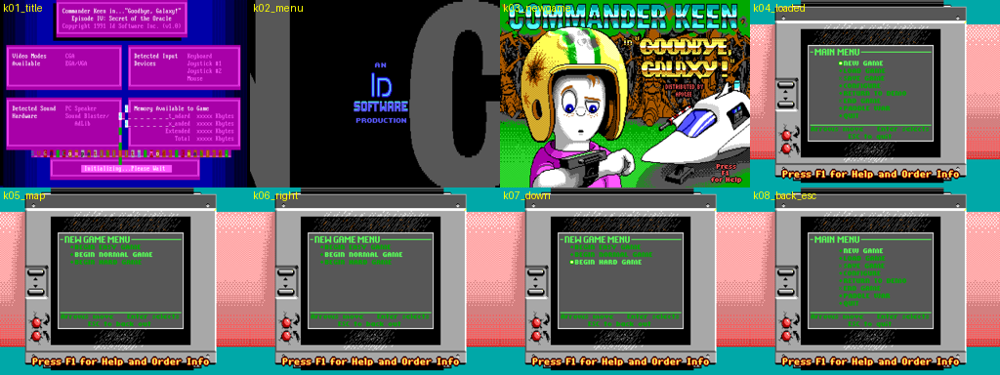

### Doom II (QEMU)
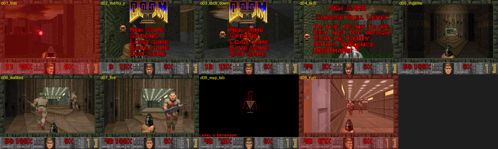

### Wolfenstein 3D (86Box)
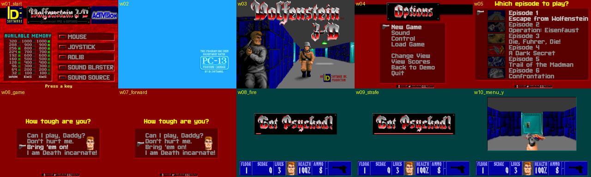
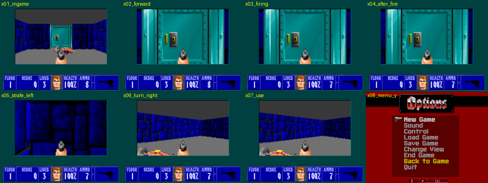

### Shareware CD games (86Box)
Steps: start, Start ×2, A, Start, D-pad right, A B X, stick left, Back.

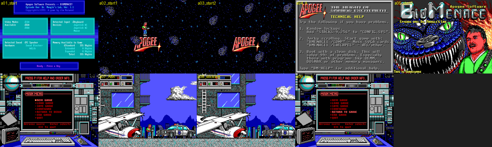
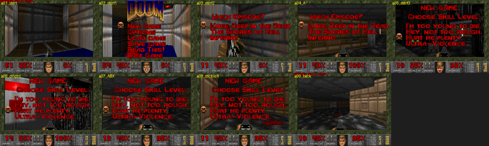
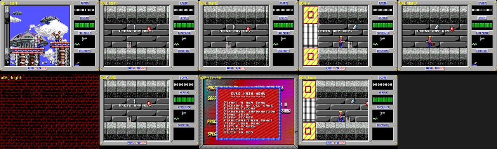
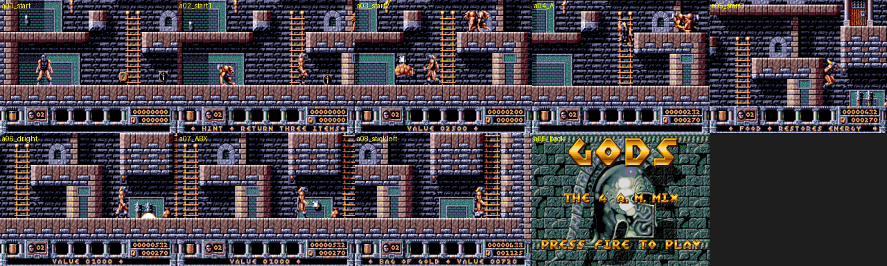
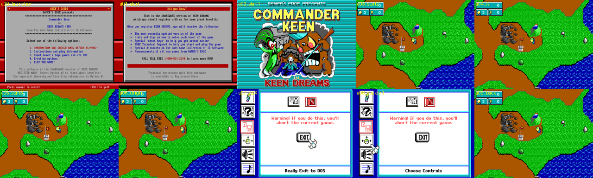
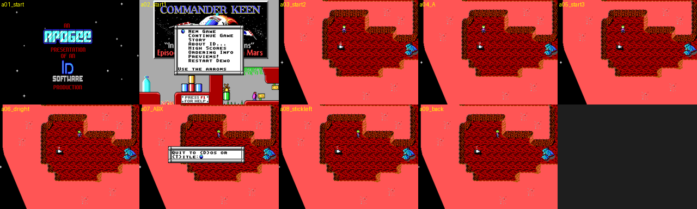
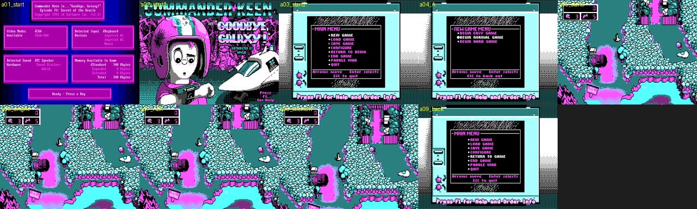
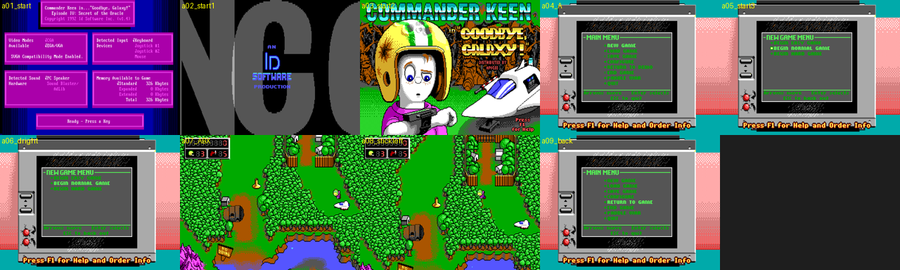
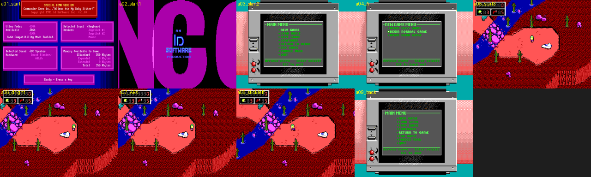
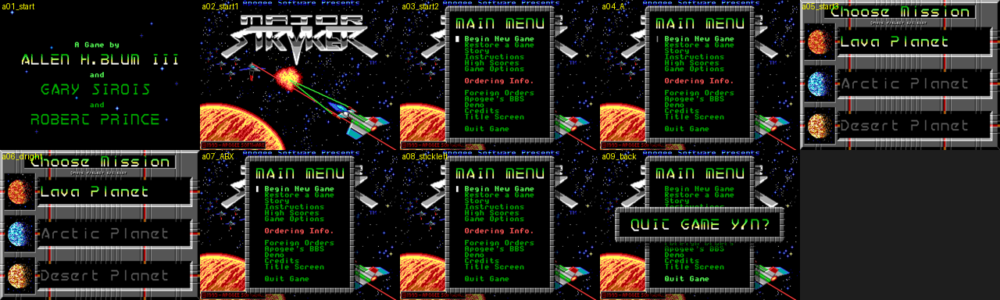
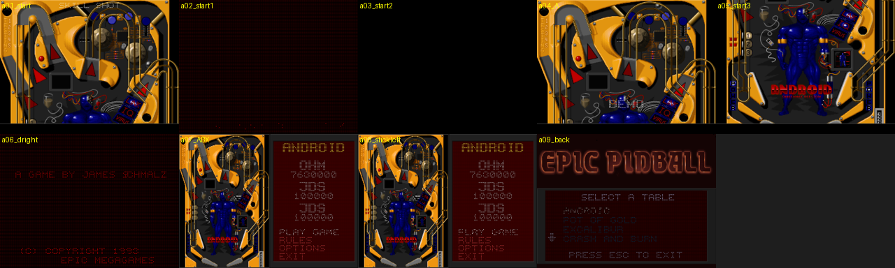
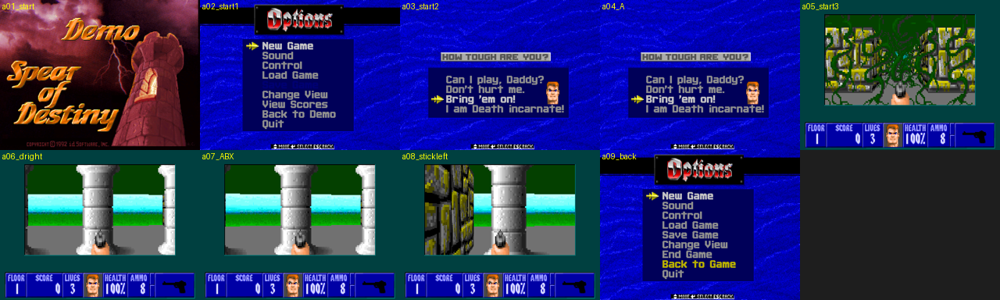
